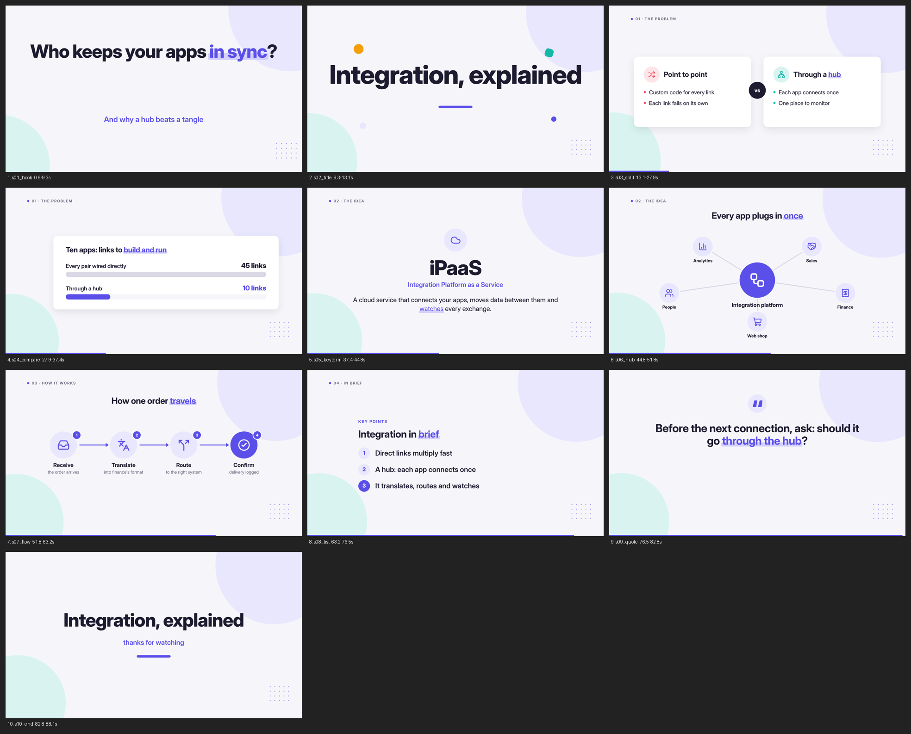
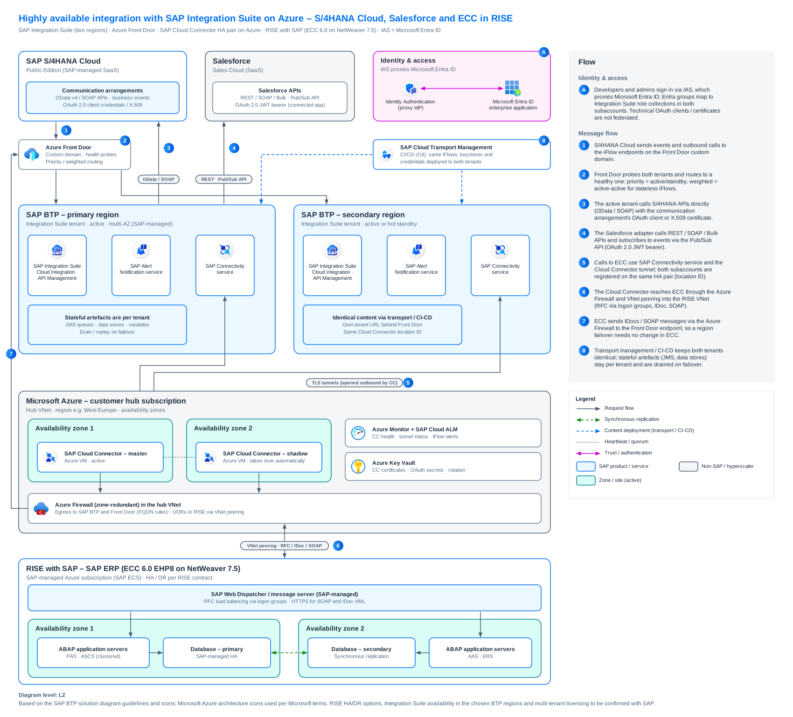
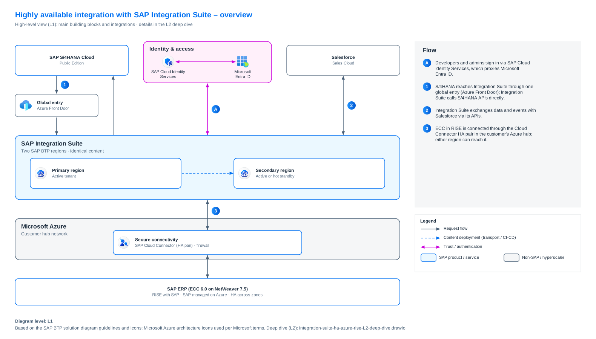
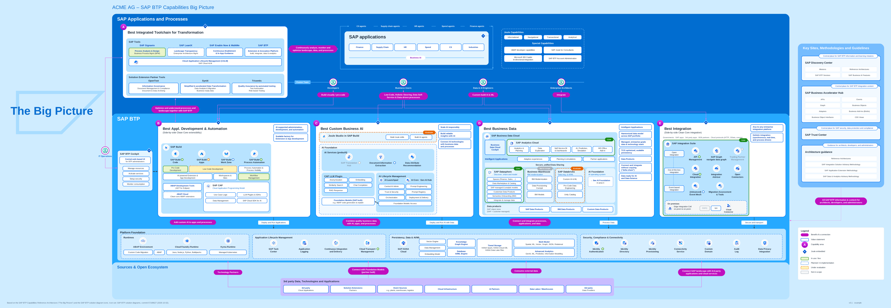

# Claude Public Skills

A collection of [Agent Skills](https://docs.claude.com/en/docs/agents-and-tools/agent-skills/overview) for
Claude (Claude.ai, Claude Code and the Claude Agent SDK). Each skill is a self-contained folder with a
`SKILL.md` (instructions + frontmatter) and any scripts, references and assets it needs.

## Skills

| Skill | What it does |
|---|---|
| [`business-explainer`](skills/business-explainer/SKILL.md) | Produces a narrated business explainer video in a clean flat-vector style: one off-screen British narrator (ElevenLabs via fal), unDraw illustrations, Lucide icon diagrams, animated stats and lists, ducked series theme. Renders a 1920×1080 MP4 plus a review sheet. |
| [`sap-btp-solution-diagrams`](skills/sap-btp-solution-diagrams/SKILL.md) | Creates SAP BTP solution diagrams / reference architectures in the official SAP BTP diagram style as editable draw.io (`.drawio`) files, with bundled SAP BTP service icons and Microsoft Azure architecture icons. Always delivers an L1 overview and an L2 deep dive. |
| [`sap-btp-big-picture`](skills/sap-btp-big-picture/SKILL.md) | Builds "The Big Picture" – the SAP BTP capabilities reference-architecture poster (areas A–E, Platform Foundation, Open Ecosystem, Key Sites) – as one editable `.drawio`, either generic or tailored to an organisation with a live / planned / evaluate / out-of-scope status overlay. Uses the official SAP BTP solution-diagram icons and builds on `sap-btp-solution-diagrams`. |
| [`sap-btp-frontend`](skills/sap-btp-frontend/SKILL.md) | Entry point for SAP BTP frontend work (SAPUI5/OpenUI5, UI5 Web Components, UI5 Web Components for React, CAP, Fiori): picks the stack and output environment, then routes to the matching deep skill. Holds Fiori floorplan / action-placement guidance, CAP project conventions, SAP MCP server usage and a BTP deployment checklist itself. |
| [`leanix-reporting`](skills/leanix-reporting/SKILL.md) **(prototype)** | Reference for building SAP LeanIX EAM custom reports with `@leanix/reporting` and the `lxr` CLI: `lx.init()` / `lx.ready()` lifecycle, `ReportConfiguration`, facet filters and callbacks, GraphQL via `lx.executeGraphQL()`, side panes, state persistence, translation and field metadata. |

## Repository layout

```
skills/
├── business-explainer/
│   ├── SKILL.md                     # instructions + embedded toolkit (scripts, CSS, JS, template)
│   └── examples/integration-teaser/ # example script.json + review sheet
├── sap-btp-solution-diagrams/
│   ├── SKILL.md
│   ├── scripts/
│   │   ├── btpdiagram.py            # diagram library (writes .drawio, optional PNG preview)
│   │   └── find_icon.py             # search the bundled icon libraries
│   ├── assets/
│   │   ├── sap_btp_icons.json       # 76 official SAP BTP service icons
│   │   ├── azure_icons.json         # 627 Microsoft Azure architecture icons
│   │   └── azure-icons-terms-of-use.pdf
│   ├── references/
│   │   ├── style-guide.md           # palette, element catalogue, layout grid
│   │   └── azure.md                 # Azure icon usage rules + role-to-icon mapping
│   └── examples/                    # L1/L2 example layouts (easy archive, Integration Suite)
├── sap-btp-big-picture/
│   ├── SKILL.md
│   ├── scripts/
│   │   ├── bigpicture.py            # poster library (imports btpdiagram.py from the sibling skill)
│   │   ├── find_icon.py
│   │   └── update_icons.py          # refreshes icons from github.com/SAP/btp-solution-diagrams
│   ├── assets/                      # official SAP icon set (Apache-2.0), manifest, brand-red theme
│   ├── references/                  # catalogue, style guide, team conventions
│   └── examples/                    # reference poster script, status + landscape configs
├── sap-btp-frontend/
│   └── SKILL.md                     # stack decision, routing table, Fiori + CAP guidance
└── leanix-reporting/                # prototype
    └── SKILL.md                     # API and CLI reference, patterns, workflow
```

## Installation

**Claude.ai** – zip a skill folder (e.g. `skills/sap-btp-solution-diagrams`) and upload it under
*Settings → Capabilities → Skills*.

**Claude Code** – copy or symlink the folder into your personal or project skills directory:

```bash
git clone https://github.com/bright-fellow/claude-public-skills.git
```

```bash
cp -r claude-public-skills/skills/* ~/.claude/skills/
```

(or into `<project>/.claude/skills/` to share the skills with a project).

## Notes per skill

### business-explainer

- The whole toolkit (`setup.sh`, `assets/*.css|js|html`, `scripts/*.py`) is embedded in `SKILL.md` as
  four-backtick code blocks tagged `file=<path>`; §0 of the skill extracts them to `~/.biz-explainer` and runs the
  setup. There are no separate asset files to install.
- Setup needs network access (npm for GSAP, Lucide and HyperFrames; Google Fonts for Inter; an optional
  Whisper model) and a headless Chrome/Chromium.
- Narration uses the paid `elevenlabs/tts/eleven-v4` endpoint on [fal](https://fal.ai); the skill always
  shows a cost estimate and waits for approval before generating audio.
- **Free alternative for the voice:** [Kokoro TTS](https://kokorottsai.com/) can be used instead of fal /
  ElevenLabs at no cost. The skill is built around fal's ElevenLabs endpoint (it uses its word timestamps for
  the cues), so a Kokoro voice-over needs a small change to `voices.py`; lines without timestamps fall back to
  estimated word timing.
- Illustrations come from [unDraw](https://undraw.co), downloaded by the user.

#### How the skill works

The film is written as a `script.json` of **beats**. Each beat is one or two sentences for the narrator
(`say`); a beat with a `show` block starts a new scene. Scene elements are **cued on spoken words**
(`"at": "routes"`), so after voicing the build step looks up each word's timestamp and the diagram, number or
bullet appears exactly when the narrator says it.

Every film has the same frame: a **hook** question → a silent **title card** → problem → idea → how it works
→ why it matters → **key points** → a **closing thought** → **end card**. Scene types: `hook`, `title`,
`illustration`, `flow`, `hub`, `stat`, `compare`, `split`, `list`, `keyterm`, `quote`, `end`, `blank`.

Pipeline (`X` = `~/.biz-explainer`, `WORK` = one folder per film):

| Step | Command | Cost |
|---|---|---|
| Estimate length and price | `voices.py cost WORK` | free |
| Silent draft timing (≈140 wpm) | `voices.py draft WORK` | free |
| Resolve cues → HyperFrames project | `build.py WORK` | free |
| Review sheet (every scene fully built) | `render.py WORK --preview` | free |
| Voice the lines (after your go-ahead) | `voices.py jobs` → fal `submit_jobs` → `voices.py collect` / `build --check` | ≈ $0.08 per 1,000 characters |
| Rebuild on the real voice, mix theme, render | `build.py` → `mix.py` → `render.py WORK` | free |

It always starts with a 60–90 s **teaser**; the full 3–5 min film follows only once the style is approved.

#### Example: "Integration, explained" (teaser)

[`examples/integration-teaser/script.json`](skills/business-explainer/examples/integration-teaser/script.json)
is a complete teaser: 13 beats, 10 scenes, 182 words, about 88 s, roughly $0.08 to voice (1,033 characters).
It uses diagram scenes only, so no unDraw downloads are needed:

| # | Scene | What the narrator says / what builds on screen |
|---|---|---|
| 1 | `hook` | "…all hold the same customer. So who makes sure they agree?" – *Who keeps your apps in sync?* |
| 2 | `title` | silent – *Integration, explained* |
| 3 | `split` | point-to-point vs. through a hub, each line cued on its word |
| 4 | `compare` | 10 apps: up to 45 direct links vs. 10 through a hub (n·(n−1)/2, no external source needed) |
| 5 | `keyterm` | *iPaaS* – Integration Platform as a Service, spelled out when first spoken |
| 6 | `hub` | sales, finance, web shop, people, analytics plug into one platform |
| 7 | `flow` | receive → translate → route → confirm, one order travelling through |
| 8 | `list` | three key points, each appearing on its own sentence |
| 9 | `quote` | closing thought: *Before the next connection, ask: should it go through the hub?* |
| 10 | `end` | *Integration, explained – thanks for watching* |

Review sheet from the free draft build (silent timing, 0 build warnings):



Reproduce it:

```bash
mkdir -p ~/films/integration-teaser && cp skills/business-explainer/examples/integration-teaser/script.json ~/films/integration-teaser/
```

```bash
cd ~/.biz-explainer/scripts && python3 voices.py draft ~/films/integration-teaser && python3 build.py ~/films/integration-teaser && python3 render.py ~/films/integration-teaser --preview
```

For the finished MP4, voice the script (§2d in the skill), put the series theme at `WORK/music.mp3`, then run
`build.py`, `mix.py` and `render.py WORK`.

### sap-btp-solution-diagrams

- Pure Python, no network needed. `cairosvg` is optional and only used to render a PNG preview for
  self-checking (`pip install cairosvg`).
- Quick test:

  ```bash
  python3 skills/sap-btp-solution-diagrams/examples/easy_archive_L1_overview.py /tmp/easy-archive-L1
  ```

  This writes `/tmp/easy-archive-L1.drawio`, which opens in diagrams.net, draw.io desktop or the VS Code
  draw.io extension.
#### How the skill works

Every architecture is drawn at **two levels** that share names, colours and step numbers: an **L1 overview**
(products and platforms only, 6–10 blocks) and an **L2 deep dive** (services, zones, networking, HA/DR,
protocol pills, full flow panel). A diagram is a short Python layout script against `scripts/btpdiagram.py`
(`area`, `box`, `service`, `icon`, `edge`, `pill`, `num`, `flow_panel`, `legend`, `footer`). `save()` writes the
`.drawio`, checks the layout (text overflow, overlaps, connectors crossing boxes, off-page elements) and renders
a PNG preview for self-checking. Colour carries meaning: blue = SAP, grey = non-SAP / hyperscaler,
teal = zones and regions, pink = trust and identity, dashed = optional or operational scope.

#### Example: SAP Integration Suite, high availability across two regions, with SAP and Azure components

Files in [`examples/output/`](skills/sap-btp-solution-diagrams/examples/output/), built from
`examples/integration_suite_L2_deep_dive.py` and `examples/integration_suite_L1_overview.py` (0 layout warnings):

- `integration-suite-ha-azure-rise-L2-deep-dive.drawio`
- `integration-suite-ha-azure-rise-L1-overview.drawio`

What the design encodes:

- **Two Integration Suite tenants** in a primary and a secondary SAP BTP region (active, or hot standby),
  kept identical by SAP Cloud Transport Management / CI/CD from Git. Stateful artefacts (JMS queues, data
  stores) stay per tenant and are drained on failover.
- **Azure Front Door** as the single global entry: custom domain, health probes, priority (active/standby)
  or weighted (active-active for stateless iFlows) routing. S/4HANA Cloud and ECC call the Front Door
  endpoint, so a region failover needs no change in the senders.
- **SaaS endpoints**: SAP S/4HANA Cloud (OData / SOAP, events) and Salesforce (REST / SOAP / Bulk, Pub/Sub API).
- **Customer Azure hub**: SAP Cloud Connector master/shadow pair across two availability zones, registered
  in both subaccounts with the same location ID; zone-redundant Azure Firewall; Azure Key Vault; Azure
  Monitor + SAP Cloud ALM.
- **RISE with SAP**: ECC 6.0 on NetWeaver 7.5 in an SAP-managed Azure subscription, reached through VNet
  peering (RFC, IDoc, SOAP), with application servers and HA database replication across two zones.
- **Identity**: SAP Identity Authentication proxies Microsoft Entra ID for developers and admins; technical
  OAuth clients and certificates are not federated.

L2 deep dive (PNG preview, the deliverable is the `.drawio`):



L1 overview:



To be confirmed per project (stated in the diagram footer): RISE HA/DR options, Integration Suite
availability in the chosen BTP regions, and multi-tenant licensing.

- Paths such as `/mnt/user-data/outputs/` and `/home/claude/preview/` in `SKILL.md` refer to the Claude.ai
  sandbox; adjust them when running elsewhere.

### sap-btp-big-picture

- Needs `sap-btp-solution-diagrams` installed next to it (as in this repo) or `BTP_DIAGRAM_SKILL` pointing at it.
- Generic poster:

  ```bash
  python3 skills/sap-btp-big-picture/examples/big_picture_reference.py /tmp/big-picture
  ```

- Tailored poster from a landscape config (theme, chips, current solutions, statuses):

  ```bash
  python3 skills/sap-btp-big-picture/examples/big_picture_reference.py /tmp/our-big-picture --config skills/sap-btp-big-picture/examples/our_landscape.json
  ```

- `scripts/update_icons.py --check` compares the bundled icon set with the latest SAP upstream commit and
  caches newer icons in `~/.cache/sap-btp-big-picture/` (needs network; falls back to the bundled set offline).
- **Example: ACME AG customer Big Picture** (fictional company) in
  [`examples/output/`](skills/sap-btp-big-picture/examples/output/): the reference poster with the status overlay
  from `examples/customer_status_example.json`, built with

  ```bash
  python3 skills/sap-btp-big-picture/examples/big_picture_reference.py skills/sap-btp-big-picture/examples/output/acme-sap-btp-big-picture --status skills/sap-btp-big-picture/examples/customer_status_example.json --customer "ACME AG" --version "v0.1 · example"
  ```

  Statuses: **live** (green) e.g. SAP Build Code, Process Automation, Integration Suite, Cloud Integration,
  API Management, SAP Datasphere, SAP Analytics Cloud, Identity Authentication; **planned** (blue dashed) e.g.
  Build Work Zone, ABAP Cloud, Advanced Event Mesh, Document Information Extraction; **evaluate** (orange dashed)
  e.g. Build Apps, SAP Databricks, Joule Studio; **out of scope** (grey) e.g. Business Warehouse, PI/PO, Trading
  Partner Management, SAP Translation Hub. Everything else stays neutral. 0 layout warnings; icon set
  SAP/btp-solution-diagrams commit `57199627` (2026-10-02).

  

- `references/our-conventions.md` and `examples/our_landscape.json` hold one team's own rules and landscape
  (brand-red theme, current systems). Replace them with your own.

### sap-btp-frontend

- A routing hub: for UI5 API depth it hands off to `sapui5`, `ui5-webcomponents`, `ui5-webcomponents-react`
  and `sap-ci-custom-adapter`, which are **not in this repository yet**. Without them it still covers stack
  choice, Fiori floorplans, CAP structure, tooling and the BTP deployment checklist; architecture diagrams
  route to `sap-btp-solution-diagrams` (included).
- In coding sessions it prefers the SAP MCP servers (`@ui5/mcp-server`, `@cap-js/mcp-server`,
  `@sap-ux/fiori-mcp-server`) when they are configured.

### leanix-reporting (prototype)

- Status: **prototype**. A knowledge-only skill (no scripts or assets), not yet tested against a live
  LeanIX workspace; check API details against the [typings docs](https://leanix.github.io/leanix-reporting/)
  and the [official examples](https://github.com/leanix/leanix-reporting/tree/main/examples).
- Building and uploading a report needs Node.js, `npm install -g @leanix/reporting-cli` and access to a
  LeanIX workspace (`lxr init` → `lxr start` → `lxr upload`).

## Third-party content and licences

- **Microsoft Azure architecture icons** (`assets/azure_icons.json`) are © Microsoft and are bundled for
  use in architecture diagrams under Microsoft's terms (see
  [`azure-icons-terms-of-use.pdf`](skills/sap-btp-solution-diagrams/assets/azure-icons-terms-of-use.pdf)):
  use them in diagrams, training material and documentation; don't crop, distort or use them to represent
  your own product. Converted via
  [dwarfered/azure-architecture-icons-for-drawio](https://github.com/dwarfered/azure-architecture-icons-for-drawio).
- **SAP BTP icons** (`assets/sap_btp_icons.json`) and the diagram style follow SAP's public
  [BTP solution diagram guidelines](https://github.com/SAP-archive/sap-btp-reference-architectures).
  SAP and the SAP logo are trademarks of SAP SE.
- **Official SAP BTP solution-diagram icons** in `sap-btp-big-picture/assets/sap_official_icons.json` come from
  [SAP/btp-solution-diagrams](https://github.com/SAP/btp-solution-diagrams) under Apache-2.0 (licence text
  bundled as `LICENSE-btp-solution-diagrams.txt`).
- unDraw, Lucide, GSAP, Inter and HyperFrames used by `business-explainer` are fetched at setup time and
  are subject to their own licences.

## License

[MIT](LICENSE) © 2026 Andreas Katzer – free to use, modify and redistribute, **including commercially**.

The one condition is credit: keep the copyright and licence notice in every copy or substantial portion
(for example the `LICENSE` file, or the notice at the top of a copied skill). A visible credit is
appreciated, e.g.:

> Based on [claude-public-skills](https://github.com/bright-fellow/claude-public-skills) by Andreas Katzer (MIT).

Bundled third-party icons are not covered by MIT and keep their own terms (see
[Third-party content and licences](#third-party-content-and-licences)).

